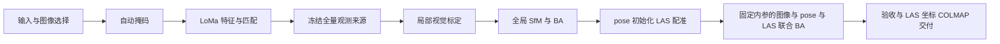

# GeosunPre

将 Geosun 异步 L/R 双鱼眼采集数据自动处理为 **COLMAP 数据集**：



新运行默认 `production + local + joint`：保留局部视觉标定，使用全部通过质量筛选的图像观测，再完成 LAS 配准和图像主导的固定内参联合 BA。最终相机与三维点位于输入 LAS 的 XYZ 坐标中。联合候选未通过验收时，交付通过验收的全局配准模型；全局配准也失败则停止交付。详见 [模式说明](docs/production_pipeline.md) 和 [配准验收](docs/las_alignment.md#默认主流程与交付选择)。

每次曝光独立求位姿，每个镜头共享一组 `OPENCV_FISHEYE` 内参。导出保持原图和原生鱼眼模型，不去畸变。流程无需逐场景人工标注；设备遮挡使用代码中版本化的固定规则。

## 安装与运行

运行完整流程需要 Linux、可用的 NVIDIA GPU，以及 LoMa 和 SegFormer 权重。Python 版本为 3.13 或更高，依赖由 `uv.lock` 固定。安装原生 BA 需要 C++17 编译器和 Python 开发头文件。新运行默认使用 FlashAttention、CUDA Graph 和 4 线程原生 BA。

```bash
uv sync --locked --extra loma --extra segmentation

# 从旧版本升级时重建原生联合约束
uv sync --locked --extra loma --extra segmentation --reinstall-package geosunpre-native

# 已安装依赖并准备好本地权重时，一键启动或继续篮球场任务
./run.sh
```

`run.sh` 自动定位仓库目录，默认使用 `input/篮球场`、`configs/basketball.toml` 和
`work/basketball_joint_pipeline_01`，复制原图并导出掩码。重复执行同一命令会读取冻结任务续跑。
脚本启用离线权重加载和 `uv --offline --no-sync`，不自动安装依赖；缺少 LoMa 权重时直接报出文件路径。
可透传 `run` 参数，例如 `./run.sh --work work/basketball_joint_pipeline_02` 新建另一轮任务，
`./run.sh --work work/basketball_joint_pipeline_01 --stage export` 只重导出。脚本中的相对路径以仓库为基准。

直接使用 CLI 可自行选择输入和工作目录：

```bash
uv run --no-sync geosunpre run \
  --input input/篮球场 \
  --work work/basketball_pipeline_01 \
  --config configs/basketball.toml \
  --include-masks
```

`run` 内置输入、GPU/后端、权重缓存和交付磁盘预检，最后完成质量验收与导出回读校验。
接收方可单独运行 `geosunpre check --output /path/to/colmap` 验包。

默认输出 `WORK/colmap/`，**复制原图**，可整体搬走。`--image-mode link` 可节省本机空间；`--include-masks` 附带有效域掩码，`--include-ply` 附带全部稀疏点的 PLY。输出不含下游训练配置，也不划分 3DGS 训练/测试集。

### 输入约定

```text
input/场景/
  场景.pro
  场景_CameraPos_C2E.txt
  场景_pos.txt
  场景_pos_ENH.txt
  ResultOut/场景.las
  Image/
    L/0000/*.JPG
    R/0000/*.JPG
```

- `.pro` 提供 L/R 图像尺寸和初始内参。
- 图像文件名采用 `GPS周-秒-毫秒_帧号-L或R.JPG`；只有存在精确同名 CameraPos 记录的 L/R 图像入选。缺失被引用图像、尺寸错误或重复身份会报错。
- 图像 SfM 使用视觉观测。随后 CameraPos 位置用于初始化全局配准，并作为联合 BA 的弱先验；LAS 表面提供点到面约束。导航时间戳与原始四元数保持原样，四元数不参与求解；M 图像不参与建图。
- 默认读取唯一的 `ResultOut/*.las`；多份 LAS 时设置 `registration_las`。当前支持未压缩 LAS 1.2、点格式 0–3。初始化使用显式的 `enh_first` 坐标假设，完整输入身份与限制见 [配准说明](docs/las_alignment.md)。
- L/R 不要求同一帧号同时存在；同帧号不意味着同步曝光。最终模型必须注册全部入选图像。

### 场景配置

`--config` 接受 TOML。篮球场参考配置保留已实跑的选择条件：

```toml
expected_images = 536
calibration_frames = [70, 94]  # 包含首尾
matcher_attention = "flash"
pipeline_mode = "production"
calibration_mode = "local"
registration_mode = "joint"
registration_pose_frame = "enh_first"
```

省略配置时，不限制总图像数，按帧号排序，自动选择首个包含 L/R 的 25 个不同帧号窗口；帧数不足时使用可用帧，可用 `calibration_frame_count` 调整。显式 `calibration_frames` 优先。标定片段必须包含 L/R 两个镜头，并有至少两个不同帧号；这些只是输入检查，实际是否能标定由视觉匹配与建图决定。

正式默认 `calibration_mode = "local"`。局部标定消融支持保留这一步；
`input` 初始化及对照结果见 [局部标定消融](docs/calibration_ablation.md)。
研发对照使用 `pipeline_mode = "validation"` 和新工作目录，详见 [模式说明](docs/production_pipeline.md)。
纯图像消融可显式设置 `registration_mode = "visual"`，使用新目录；其结果保留视觉坐标。

160° FOV、设备遮挡、特征和求解规则沿用当前 Geosun 设备配方。更换设备需要适配其标定与遮挡规则；当前并非任意相机输入框架。

### 当前默认与验证结果

2026-09-30 默认联合流程完整冷启动通过：536 张全部注册、75,835 点、483,034 条观测、
0 无效深度。联合分支通过图像检查，但 4 个固定瓦片发生局部几何退化，
最终自动采用已验收的全局配准模型，交付为 LAS 坐标。137 项测试、独立验包、全部观测重新投影
和整条流程续跑均通过；8,765 个数值及冻结文件保持一致。

统一流程时钟为 **27 分 45.13 秒**，GNU time 为 26 分 54.56 秒；本轮两种时钟读数有差异，
保留原始记录，不作速度提升结论。两种计时均未达到 20 分钟目标。
未划分图像留出集，拟合残差不等于测试精度；本轮未训练 3DGS。
新结果与历史纯图像运行分别保存在 [生产运行记录](docs/production_pipeline.md)。

篮球场配方对整体及每个镜头的拟合残差设置 median ≤ 2 px、P90 ≤ 4 px，并拒绝内参触界。
这些是生产交付门槛，不能作为独立精度结论；通用默认不设置残差上限、触界记为告警。

`configs/basketball.toml` 是唯一正式篮球场配置，默认启用特征缓存、CPU 并行处理和
原生深度约束 BA。原生扩展固定兼容 pyceres 2.6 / Ceres 2.2.0，随主工程安装；缺失时直接报错。
历史验证模式的性能、资源和消融结果见 [验证记录索引](docs/benchmarks/README.md)。

### 权重缓存

- LoMa：`TORCH_HOME`，默认当前目录的 `.cache/torch/`。
- SegFormer：`--model-cache` > `HF_HUB_CACHE` > 当前目录的 `.cache/huggingface/`。
- 已有权重可直接通过路径复用，无需复制旧工程的中间数据。离线时可设置 `HF_HUB_OFFLINE=1`，前提是权重齐全。

`run.sh` 自动设置仓库内的默认缓存路径，也接受已有的 `TORCH_HOME`、`HF_HUB_CACHE` 或显式 `--model-cache`。
LoMa 需要 `hub/checkpoints/` 下的 `dad.pth`、`dinov2_vitl14_pretrain.pth` 和 `loma_B.pt`。
SegFormer 的缓存根目录是 `.cache/huggingface/`；其下的 `models--nvidia--segformer-b2-finetuned-ade-512-512/`
是 Hugging Face 管理的模型目录，包含 `blobs/` 和 `snapshots/`，不能作为 `--model-cache` 的根目录。
本机缓存的固定版本 `de01bae28967510f9ddd496c60a969357195400c` 已补齐配置和 `pytorch_model.bin`，
权重从已有本地缓存复制并验证哈希，无需联网下载，也不依赖旧工作目录。
权重保存在本机忽略跟踪的 `.cache/` 中，不随 Git 分发。

## 续跑与分阶段运行

同一个工作目录会保存配置、输入身份、阶段状态和缓存。重跑会验证上游身份并复用完整产物。旧工作目录按冻结配置续跑：版本 1 未写匹配后端时按 math 解释，显式 flash 仍按 flash 执行。新默认不改写旧配置；续跑时省略 `--config`。配置或输入改变时使用新目录；工作目录有进程锁，防止两个运行同时写入。

```bash
# 继续同一轮运行，自动读取已保存的输入路径和配置
uv run --no-sync geosunpre run --work work/basketball_pipeline_01

# 仅执行一个阶段；其上游产物须已完成
uv run --no-sync geosunpre run --work work/basketball_pipeline_01 --stage calibration
```

生产阶段：`prepare → masks → features → matches → observations → calibration → sfm → finalize → register → export`，默认 `all`。验证模式将 `observations` 替换为 `holdout`。新配置版本 5 默认 joint，版本 1–4 的冻结配置保留 visual 行为；版本 1/2/3 继续按验证模式运行。旧配置兼容不绕过数值源码身份检查。

`pipeline_task.json` 冻结程序、依赖、设备配方、后端和导出选项。续跑自动继承输出路径、掩码/PLY、复制/链接及模型缓存路径；同一输出目录禁止改变选项，另行导出可指定新的 `--output`。
数值源码、依赖、后端或场景配置改变时使用新工作目录，错误会列出具体变化项。
仅 `pipeline/preflight.py`（资源预检）和 `pipeline/task.py`（任务身份管理）的修改允许续跑，
保留原任务文件，并写入 `pipeline_execution_audit.json`；这两个模块不参与数值拟合。
旧目录首次续跑会读取已有交付选项并补建任务身份，明确标记旧产物缺少执行版本记录，原冻结协议不改写。

`pipeline_status.json` 记录最近一次调用的阶段、统一时钟耗时和失败原因；`run_result.json` 记录最近成功调用，并用 `delivery_complete` 表示是否完成交付。
建图和 BA 子阶段先在临时目录写完整模型与报告，再发布；未提交的旧数据库或部分模型会归档为 `*.interrupted-*`，续跑从上一个完整结果开始。
已提交结果发生内容或身份变化会报错。详细边界见[工程结构与运行说明](docs/engineering_structure.md)。

## 单独导出已有模型

```bash
uv run --no-sync geosunpre export \
  --scene /path/to/manifest.json \
  --model /path/to/sparse/0 \
  --output /path/to/colmap \
  --include-masks
uv run --no-sync geosunpre check --output /path/to/colmap
```

导出先在临时目录中回读校验，再发布完整目录。`check` 在复制模式下只需交付包，不依赖原始工作目录。模型和图像内容校验通过，代表交付完整；几何质量仍需参考附带评估和应用效果。

## 项目结构与验证

已有纯图像交付可以通过独立的 `geosunpre align` 生成 LAS 全局配准候选、空间留出误差与
原生鱼眼投影对照。`inspect-alignment` 可继续定位低支持区域、核对原图和 LAS 不同时段局部几何。
`refine-alignment` 在冻结参考候选和空间划分的基础上，用可靠结构做独立细化对照。
`joint-alignment` 进一步比较固定内参的纯图像 BA、图像加 pose、图像加 pose 和 LAS，
共优化相机位姿、三维点与全局配准，并检查逐图像及分区误差。
默认 `register` 复用全局配准和联合 BA 部件，自动执行纯 BA 对照及 pose + LAS 分支；上述命令保留独立诊断与三方案对照。使用方法、篮球场结果和验收边界见 [LAS 配准说明](docs/las_alignment.md)。

| 目录 | 内容 |
| --- | --- |
| `src/geosunpre/` | 输入、相机、自动掩码、特征、配置、COLMAP 交付 |
| `src/geosunpre/pipeline/` | 阶段编排、标定、重建、生产诊断与验证评估 |
| `src/geosunpre/alignment/` | LAS 配准、联合 BA、候选发布与诊断 |
| `src/geosunpre/sfm/` | 几何、轨迹、BA、深度约束和评估 |
| `configs/` | 正式场景配置 |
| `native/` | 原生 Ceres 深度约束扩展及第三方许可证 |
| `tests/` | 数值、阶段身份、恢复保护和导出测试 |
| `docs/` | [文档索引](docs/README.md)、流程与交付契约、验证记录 |

```bash
uv run --no-sync pytest -q tests
```

仓库保留正式 `run / export / check` 入口，以及独立诊断命令 `align / inspect-alignment / refine-alignment / joint-alignment`。数据、完整实验日志和权重分别保存在忽略跟踪的 `input/`、`work/`、`.cache/`；验证摘要随文档保存。目录职责、保留范围及迁移规则见 [仓库整理说明](docs/repository.md)。
