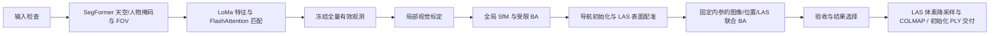

# GeosunPre

将 Geosun 异步 L/R 双鱼眼图像、导航位置和 LAS 处理为可直接交付给鱼眼 3DGS 训练器的 COLMAP 数据集。项目只有一条生产流程：



每次曝光独立求位姿，L/R 各共享一组原生 `OPENCV_FISHEYE` 内参。输出保持原图，不缩放、不去畸变；相机和全部稀疏点位于输入 LAS 的 XYZ 坐标中。下游训练器须支持该鱼眼模型。

联合更新未通过图像、几何或局部区域检查时，采用已经通过验收的全局配准模型；全局配准未通过则停止交付。这个保护机制是固定流程的一部分，无需选择算法模式。

## 安装与启动

完整流程需要 Linux、Python ≥ 3.13、支持 FlashAttention 的 NVIDIA CUDA GPU、C++17 编译器和 Python 开发头文件。依赖和 LoMa 源码版本由 `uv.lock` 固定，原生 Ceres 扩展随项目安装。

```bash
uv sync --locked

# 本地权重准备齐全后，启动或继续默认篮球场任务
./run.sh

# 新场景，自动选取局部标定片段
./run.sh --input input/场景 --work work/场景

# 使用自己的场景配置
./run.sh --input input/场景 --work work/场景 --config configs/场景.toml
```

默认任务使用 `input/篮球场`、`configs/basketball.toml`、`work/basketball`。重复运行自动续跑。提供自定义 `--input` 时使用通用配置；不会套用篮球场的图像数和标定窗口。脚本定位到仓库根目录并直接使用 `.venv`，运行时离线加载权重。

默认交付 `WORK/colmap`，复制原图并附带有效域掩码，以及用于 3DGS 初始化的 LAS 点云 `sparse/0/points3D.ply`。初始化点云扫描完整 LAS，默认按 5 cm 体素计算坐标和 RGB 均值，使用与验收相机一致的 LAS 坐标。`--ply-voxel-size 0.1` 改为 10 cm；`--no-include-ply` 省略初始化点云。`--image-mode link` 使用本机链接；`--no-include-masks` 省略掩码。

## 输入与权重

```text
input/场景/
  场景.pro
  场景_CameraPos_C2E.txt
  场景_pos.txt
  场景_pos_ENH.txt
  ResultOut/场景.las
  Image/L/0000/*.JPG
  Image/R/0000/*.JPG
```

只有 CameraPos 中有精确同名记录的 L/R 图像入选。文件名为 `GPS周-秒-毫秒_帧号-L或R.JPG`，L/R 同帧号不表示同步曝光，M 图像不参与重建。图像尺寸必须符合 `.pro`。LAS 支持未压缩 1.2、点格式 0–3；存在多份时通过 `registration_las` 指定。

LoMa 缓存默认为 `.cache/torch/hub/checkpoints/`，需要 `dad.pth`、`dinov2_vitl14_pretrain.pth`、`loma_B.pt`。SegFormer 缓存默认为 `.cache/huggingface/`，使用固定版本 `de01bae28967510f9ddd496c60a969357195400c`，需要配置、预处理配置和模型权重。可用 `TORCH_HOME`、`HF_HUB_CACHE`、`--model-cache` 复用已有缓存。项目运行不下载权重；完整缓存结构见 [资源与离线运行](docs/resources.md)。

导航位置用于全局配准初始化和联合求解的弱先验；输入四元数不参与求解，时间戳不改写。坐标转换采用固定 `ENH - 首个 ENH 位置` 假设，再通过 LAS 表面配准检查。输出坐标符合输入 LAS，绝对地理精度尚需外部验证。

## 配置与运行

场景配置仅包含图像选择、资源和验收条件，没有算法路线开关：

```toml
expected_images = 536
calibration_frames = [70, 94]  # 包含首尾
workers = 4
quality_max_median_px = 2.0
quality_max_p90_px = 4.0
```

不指定标定窗口时，自动选择首个同时含 L/R 的最多 25 个不同帧号窗口。完整字段和阶段契约见 [生产运行说明](docs/production_pipeline.md)。

```bash
# 续跑；自动读取输入、配置、缓存和交付选项
.venv/bin/geosunpre run --work work/场景

# 单独执行阶段，上游结果须已完成
.venv/bin/geosunpre run --work work/场景 --stage calibration

# 重新交付已验收的模型，保留冻结的默认选项
.venv/bin/geosunpre export --work work/场景 --output /path/to/colmap

# 接收方独立验包
.venv/bin/geosunpre check --output /path/to/colmap
```

阶段顺序为 `prepare → masks → features → matches → observations → calibration → sfm → finalize → register → export`。每个工作目录有进程锁，完整阶段原子发布。续跑直接比较配置、提取参数及输入/缓存的大小和修改时间；运行环境只记录版本信息。掩码统一保存在 `WORK/sfm/masks/`，只排除天空和人物，导出时叠加初始鱼眼 FOV。旧任务含固定设备掩码，使用新工作目录重新处理。

`pipeline_status.json` 保存阶段状态、失败原因、耗时和资源读数，`run_result.json` 保存最近成功调用。最终几何选择可查看 `WORK/registration/final/inspection.html`，交付质量和来源记录在 `COLMAP/quality.json` 与 `colmap_export.json`。

## 架构与运行记录

[架构审查与重构决策](docs/architecture.md)记录保留路线、删除范围和效率边界；[COLMAP 契约](docs/colmap_contract.md)说明接收方的坐标、掩码及验包方式。

[篮球场历史运行](docs/benchmarks/basketball_architecture_20261008.md)记录 2026-10-08 的 536 张图像任务：整进程 21 分 59.25 秒，RSS 高水位 4.64 GiB。该运行早于此次掩码和续跑规则调整，不能代表当前实现的耗时或重建结果。

数据、权重和运行产物分别放在忽略跟踪的 `input/`、`.cache/`、`work/`。仓库保留生产源码、场景配置和当前文档。维护时使用静态检查、必要的定向编译或实际阶段运行；不维护单元测试、回归测试及其脚本。
