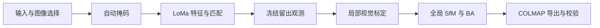

# GeosunPre

将 Geosun 异步 L/R 双鱼眼采集数据自动处理为 **COLMAP 数据集**：



每次曝光独立求位姿，每个镜头共享一组 `OPENCV_FISHEYE` 内参。导出保持原图和原生鱼眼模型，不去畸变。流程无需逐场景人工标注；设备遮挡使用代码中版本化的固定规则。

## 安装与运行

运行完整流程需要 Linux、可用的 NVIDIA GPU，以及 LoMa 和 SegFormer 权重。Python 版本为 3.13 或更高，依赖由 `uv.lock` 固定。

```bash
uv sync --locked --extra loma --extra segmentation

uv run --no-sync geosunpre run \
  --input input/篮球场 \
  --work work/basketball_pipeline_01 \
  --config configs/basketball.toml \
  --include-masks

uv run --no-sync geosunpre check --work work/basketball_pipeline_01
```

默认输出 `WORK/colmap/`，**复制原图**，可整体搬走。`--image-mode link` 可节省本机空间；`--include-masks` 附带有效域掩码，`--include-ply` 附带全部稀疏点的 PLY。输出不含下游训练配置，也不划分 3DGS 训练/测试集。

### 输入约定

```text
input/场景/
  场景.pro
  场景_CameraPos_C2E.txt
  Image/
    L/0000/*.JPG
    R/0000/*.JPG
```

- `.pro` 提供 L/R 图像尺寸和初始内参。
- 图像文件名采用 `GPS周-秒-毫秒_帧号-L或R.JPG`；只有存在精确同名 CameraPos 记录的 L/R 图像入选。缺失被引用图像、尺寸错误或重复身份会报错。
- CameraPos 只参与输入校验与图像选择，其位置、姿态数值不参与 SfM。M 图像和 LAS 不参与重建。
- L/R 不要求同一帧号同时存在；同帧号不意味着同步曝光。最终模型必须注册全部入选图像。

### 场景配置

`--config` 接受 TOML。篮球场参考配置保留已实跑的选择条件：

```toml
expected_images = 536
calibration_frames = [70, 94]  # 包含首尾
```

省略配置时，不限制总图像数，自动取前 25 个不同帧号作为标定片段；可用 `calibration_frame_count` 调整。显式 `calibration_frames` 优先。标定片段必须包含 L/R 两个镜头，并有至少两个不同帧号；这些只是输入检查，实际是否能标定由视觉匹配与建图决定。

160° FOV、设备遮挡、特征和求解规则沿用当前 Geosun 设备配方。更换设备需要适配其标定与遮挡规则；当前并非任意相机输入框架。

### 权重缓存

- LoMa：`TORCH_HOME`，默认当前目录的 `.cache/torch/`。
- SegFormer：`--model-cache` > `HF_HUB_CACHE` > 当前目录的 `.cache/huggingface/`。
- 已有权重可直接通过路径复用，无需复制旧工程的中间数据。离线时可设置 `HF_HUB_OFFLINE=1`，前提是权重齐全。

## 续跑与分阶段运行

同一个工作目录会保存配置、输入身份、阶段状态和缓存。重跑会验证上游身份并复用完整产物。配置或输入改变时使用新目录；工作目录有进程锁，防止两个运行同时写入。

```bash
# 继续同一轮运行，自动读取已保存的输入路径和配置
geosunpre run --work work/basketball_pipeline_01 --include-masks

# 仅执行一个阶段；其上游产物须已完成
geosunpre run --work work/basketball_pipeline_01 --stage calibration
```

可选阶段：`prepare → masks → features → matches → holdout → calibration → sfm → finalize → export`，默认 `all`。导出选项不属于场景配置，续跑到 `export` 时应保持一致；改变导出选项可指定新的 `--output`。

`pipeline_status.json` 记录最近一次调用的阶段、耗时和失败原因；`run_result.json` 记录最近成功调用的结果。恢复粒度为已完成的缓存或阶段，不承诺任意文件写入时刻均能自动恢复。无完成身份的部分模型会报错，处理方式见[工程结构与运行说明](docs/engineering_structure.md)。

## 单独导出已有模型

```bash
geosunpre export \
  --scene /path/to/manifest.json \
  --model /path/to/sparse/0 \
  --output /path/to/colmap \
  --include-masks
geosunpre check --output /path/to/colmap
```

导出先在临时目录中回读校验，再发布完整目录。`check` 在复制模式下只需交付包，不依赖原始工作目录。模型和图像内容校验通过，代表交付完整；几何质量仍需参考附带评估和应用效果。

## 项目结构与验证

| 目录 | 内容 |
| --- | --- |
| `src/geosunpre/` | 输入、相机、自动掩码、特征、配置、COLMAP 交付 |
| `src/geosunpre/pipeline/` | 阶段编排、标定、重建、留出与运行状态 |
| `src/geosunpre/sfm/` | 几何、轨迹、BA、深度约束和评估 |
| `configs/` | 场景选择配置 |
| `tests/` | 数值、阶段身份、恢复保护和导出测试 |
| `docs/` | [工程说明](docs/engineering_structure.md)、[COLMAP 契约](docs/colmap_contract.md)、[留出协议](docs/unified_holdout.md) |

```bash
uv run --no-sync pytest -q tests
```

本次整理将正式工程链路独立保留，移除了实验入口、历史实验实现、基线管理和下游训练配置生成。旧命令不再转发；既有 `input/`、`work/` 和权重缓存保留。新工作目录采用新布局，旧中间目录不直接续跑；已有 COLMAP 交付包仍可用 `check` 验证。
