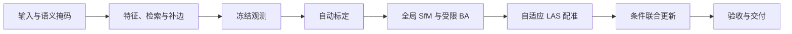

# 算法与架构

目标是同一套双鱼眼 + LAS 设备覆盖不同场景。项目使用一条生产流程，配置只表达资源、LAS 文件选择和验收限值。

Windows 默认编排和算法入口位于 `native/cpp/`，GPU 前端采用 LibTorch C++/CUDA，视觉及联合求解采用 COLMAP/Ceres，LAS 邻域采用 nanoflann。Python 模块保留为显式参考实现。移植仍沿用下述策略和验收；LAS 固定种子分层抽样采用 C++ 随机数，样本无需与 NumPy 逐条相同。[迁移记录](../native/MIGRATION.md)说明实际验证范围。

## 自动策略

| 环节 | 当前实现 |
| --- | --- |
| 设备模型 | L/R 各共享原生 `OPENCV_FISHEYE` 内参，每次异步曝光独立 frame。初始 160° FOV 限制有效域。 |
| 掩码与特征 | SegFormer 排除天空/人物；LoMa 检测分辨率 1536、最多 3072 特征。固定设备多边形和底部规则已删除。 |
| 匹配图 | 曝光顺序近邻与多时间尺度检索；按实际高置信原始匹配支持，最多修补两轮薄弱连接。无帧号取模或强制首尾候选。 |
| 标定支撑 | 验证种子视差，扩展连通子集，平衡两镜头和角度覆盖；最多 64 幅，每镜头至少三幅。四步 BA 依次释放焦距、畸变和主点。 |
| 全局重建 | 复用标定模型和特征编号，做鱼眼 E 验证、增量 SfM、轨迹筛选与共享内参 BA。未收敛时继续，定稿只验收和发布。 |
| LAS 配准 | 导航初始化 Sim3；用采样间距、坐标量化和初值残差设置多尺度，按点数和稳健跨度生成冻结区域。保留归一化七维 Jacobian 秩检查。 |
| 联合更新 | 固定内参，以图像、弱位置先验和可靠 LAS 表面更新位姿、点与 Sim3。对应不足、方向不足或已在相对噪声代理范围内时跳过。 |
| 对应权重 | 按实际法线方向、区域、支持数量和置信度平衡，取消固定水平/垂直/斜面总配比。 |

两视图和 LAS 配准使用全部合格支撑，生产流程不强制拆分描述性留出。角度覆盖、原始匹配支持与相对噪声均是代理，不能等同标定协方差、真实几何连接或完整测量不确定性。

相似度按 128 行计算，避免存储完整平方矩阵；精确检索计算量仍随图像数平方增长。补边发生在冻结观测前，最终建图继续做相机感知几何验证。

## 验收与去留

视觉交付要求全部入选曝光恰好注册一次、正深度、160° 内鱼眼单调、观测覆盖和整体/镜头拟合误差达标，内参未触及边界。

LAS 检查表面支持、空间覆盖、区域点到面残差。联合候选还检查固定观测上的整体、镜头、图像、FOV 区域和空间区域投影变化，以及固定点身份上的几何变化。候选最终也须通过绝对拟合限值；不可用或被拒绝时采用合格的全局配准模型，无合格模型则停止交付。决策集中在 `pipeline/registration.py::select_delivery`，术语见[术语表](../GLOSSARY.md)。

2026-10-09 改造前审查发现：重复定稿 BA 的目标值没有变化；两视图及 LAS 留出只作描述；联合更新未被该次交付采用。相应改造与新运行见[验证记录](benchmarks/generalization_20261009.md)，改造前数值保存在[审查证据](benchmarks/generalization_audit_20261009.json)。

| 保留或待处理项 | 原因与下一步 |
| --- | --- |
| 四步视觉标定 | 设备初值及跨场景稳定性未验证，先保留纠正能力。可靠设备标定建立后，再研究跳过局部重估及按信息释放参数。 |
| 三角形轨迹筛选、旋转筛边 | 旧产物删去大量支撑，缺少独立收益证据；应分别消融，不能凭删点后残差下降认定有效。 |
| 设备投影约定 | 主点 Y 向上、`p3` 映射第四鱼眼系数及 160° 域尚需设备定义核对。 |
| 导航坐标 | 仍假定 LAS XYZ 近似 ENH 减首个位置、单位为米；转换要求非共线支撑，长直道路/走廊仍可能受阻。输入四元数不用、时间戳不改写。 |
| 困难场景 | 尚无道路、建筑、室内原始数据验证；天空/人物掩码不覆盖全部动态对象，尚未按未注册曝光再次补匹配。 |

## 模块与依据

| 模块 | 职责 |
| --- | --- |
| `cli.py`、`config.py`、`scene.py` | 入口、通用限值与设备输入 |
| `pipeline/` | 固定编排、冻结来源、恢复、质量与交付决策 |
| `sfm/pair_selection.py`、`calibration_selection.py` | 候选图、补边与自动标定支撑 |
| `sfm/`、`native/` | 鱼眼几何、轨迹处理、受限 Ceres BA |
| `registration/` | 数据尺度、表面对应、全局配准与联合候选 |
| `artifacts.py`、`colmap.py`、`initialization.py` | 原子发布、COLMAP 与完整 LAS 初始化点云 |

局部和全局共用冻结特征编号；几何数组按需读取，自动选图会访问全场关键点。数据库、种子和完成记录一起发布，COLMAP 使用临时数据库副本。缓存与恢复规则见[生产运行](production_pipeline.md)，维护采用静态检查、定向编译和必要的实际阶段运行。

Windows 的完整原生入口由 `native/cpp/pipeline.cpp` 编排，推理子进程只负责 C++/CUDA 前端；`sfm_pipeline.cpp`、`registration.cpp`、`joint.cpp`、`delivery.cpp` 分别负责视觉、LAS、条件联合更新及交付。正深度与联合代价在 C++ 中构建和检查，数值依赖统一构建；Ceres CUDA 稠密求解可显式使用。显式 Python 参考流程仍通过 `native_runtime.py` 调用数值程序。[第一阶段数值验证](benchmarks/windows_native_20261012.md)和[完整迁移验证](benchmarks/windows_cpp_pipeline_20261012.md)分别记录对应证据。

本轮设计参考以下一手资料；它们提供算法依据，项目收益仍以实际验证为准：

- [COLMAP 共享内参与主点优化](https://colmap.github.io/faq.html)：物理镜头共享内参，主点分阶段释放。
- [SfM Revisited](https://demuc.de/papers/schoenberger2016sfm.pdf)：匹配覆盖、视差与退化处理。
- [X-ICP](https://arxiv.org/html/2211.16335v4)：几何方向支撑与尺度归一化。
- [联合 LiDAR/相机标定](https://arxiv.org/html/2308.12629v1)：可靠平面对应和视觉精度加权的条件收益。

独立几何精度与固定训练设置下的 3DGS 效果属于后续验证，拟合残差和产物验包不能替代。
