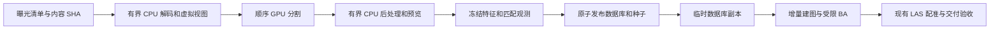

# 架构审查与彻底重构

## 审查结论

原工程的默认算法路线已经明确，但生产流程仍依赖实验对照框架。运行入口、模式配置、数值后端、留出评估、独立配准诊断和旧版本恢复规则混在同一个工程中，增加了用户选择成本和数值身份检查的复杂度。联合配准还会计算纯图像 BA 对照、生成多个候选交付和重复图像/掩码，生产运行承担了实验产物的成本。

本次以当前默认路线为唯一产品流程，直接删除其他路线及兼容层。配置只表达场景、资源和验收条件；中间结果仅保存继续求解、恢复和质量检查必需的数据。关键几何保护、内容身份、原子发布和独立验包继续保留。

## 唯一算法路线

| 环节 | 固定实现及作用 |
| --- | --- |
| 输入 | 原始 L/R 图像、初始鱼眼内参；每次异步曝光独立 frame |
| 掩码 | SegFormer 的天空/人类别，加设备固定遮挡和初始标定下的 160° FOV |
| 特征 | LoMa，检测分辨率 1536、最多 3072 特征；共享缓存供局部和全局使用 |
| 匹配 | 时间邻域加全局描述子检索；FlashAttention，CUDA Graph 复用 |
| 观测 | 全部通过筛选的观测，先冻结身份再进入几何求解 |
| 局部标定 | 自动或指定短片段；固定内参 → 焦距及低阶径向 → 全径向 → 主点的受限 BA |
| 全局重建 | 原生鱼眼增量 SfM；固定内参 BA → 三角支持轨迹筛选与 BA → 共享内参 BA |
| 视觉定稿 | 最多 40 次受限主点 BA；检查曝光完整性、投影、深度和内参边界 |
| 全局配准 | 导航位置初始化 Sim3；LAS 多尺度稳健点到面配准 |
| 联合更新 | 固定内参；图像观测主导，位置弱先验与可靠 LAS 表面共同约束位姿、点和 Sim3 |
| 初始化点云 | 完整 LAS 按 5 cm 体素计算坐标与 RGB 均值，生成同坐标框架的 3DGS 初始化 PLY |
| 交付 | 验收、选择安全结果、原子发布并回读验证 COLMAP 模型及 LAS 初始化点云 |

联合更新与未更新的输入视觉模型比较拟合投影变化；几何比较使用同一批点和固定空间区域。失去支持、局部误差增加、深度异常、位姿或尺度越界时拒绝更新。可靠联合约束不足也会使用已验收的全局配准结果。这是同一条流程的失败保护，不能通过配置切换成纯视觉路线。

图像观测全部用于拟合。LAS 固定空间诊断区域不进入求解，也不用于选择交付；保留它是为了看未拟合区域的表现。拟合残差、LAS 诊断和内容验包各有不同含义，均不等同于独立绝对精度或下游 3DGS 质量。

## 删除范围

- `validation` 全局观测留出和相关预测评估、消融报告。
- `input` 标定消融、纯视觉交付模式、可选择的导航坐标模式。
- math 匹配后端、Python 深度约束、环境变量算法切换及旧配置迁移。
- 独立 `align / inspect-alignment / refine-alignment / joint-alignment` 命令及其报告框架。
- 结构单独细化、纯图像 BA 对照和多联合方案实验。
- 任意已有模型的通用 CLI 导出；正式导出始终来源于已验收任务。
- 重复的中间 COLMAP 图像/掩码、实验可视化、旧基准摘要和失效文档。

## 当前职责

| 路径 | 职责 |
| --- | --- |
| `cli.py`、`run.sh` | `run / export / check` 和一键启动 |
| `config.py`、`scene.py` | 严格场景配置、输入选择和内容身份 |
| `pipeline/runner.py` | 固定阶段顺序、资源预检和恢复编排 |
| `pipeline/task.py`、`runtime.py` | 执行身份、按首次使用冻结权重、进程锁与阶段状态 |
| `pipeline/data.py`、`observations.py` | 掩码、特征、匹配与全量观测协议 |
| `pipeline/calibration.py`、`reconstruction.py`、`finalization.py` | 局部标定、全局 SfM 与视觉定稿 |
| `sfm/`、`native/` | 鱼眼几何、轨迹筛选、受限 BA 和 Ceres 解析约束 |
| `registration/` | 纯数值 LAS 全局配准、可靠对应与联合求解 |
| `pipeline/registration.py` | 配准产物身份、验收、结果选择和正式发布 |
| `initialization.py` | 完整 LAS 分块、体素归并、RGB 及 3DGS 初始化 PLY |
| `colmap.py` | 标准交付及不依赖工作目录的独立验包 |

没有引入插件式求解框架或通用实验调度器。图像预处理、SfM、LAS 求解、任务编排和交付保有明确的职责边界；算法配方固定在所属模块中，变更配方视为新的执行身份。

配准交付决策集中在 `pipeline/registration.py::select_delivery`：相对图像检查与 LAS 区域检查只确定联合候选是否可以继续验收，不能提前产生正式选择。候选通过整体及各镜头绝对拟合限值后才可交付；限值拒绝时改验全局结果。只有明确的拟合验收拒绝可触发此回退，身份损坏、模型不变量失败和计算异常仍停止。编排与原子发布接收同一份已完成的选择和质量记录；领域名称见 [术语表](../GLOSSARY.md)。

冻结观测读取集中在 `pipeline/data.py::load_frontend`。它检查共享提取输入身份、缓存元数据和完整观测协议，返回按图像名读取的特征目录；首次请求数组时，读取前后对照冻结协议中的文件 SHA。局部标定仅请求所选片段，定稿、已完成模型验收和导出仅验证来源身份。首次冻结仍读取并检查全部特征与匹配；真正建立全局数据库前一次性物化数组供并行几何使用。提取、资源预检和几何读取共用 `features.py` 的身份规则，观测协议仍冻结完整缓存字节，保留原字段、版本及特征索引。

## 使用与效率结论

安装命令收敛为 `uv sync --locked`，无需选择 extras。新场景一条命令启动；同一命令续跑；缺资源时在数值阶段前报错；`prepare` 不要求模型权重，权重准备完成后仍可继续。只导出已完成任务时可复用缓存，无需初始化 GPU。

从执行结构上减少了一次纯图像 BA 对照、多个候选导出、重复图像处理和实验报告生成，实际收益取决于场景。保留 CUDA Graph、GPU 特征 LRU、CPU 缓存、并行 LAS 查询、原生多线程 BA 和单次调用的哈希复用。

初始重构通过合成数据和实际 Ceres 求解验证数值与工程契约。后续两项架构改进已完成[篮球场真实验收](benchmarks/basketball_architecture_20261008.md)：536 张图像完整交付并独立验包，整进程 21 分 59.25 秒、RSS 高水位 4.64 GiB；篮球场 20 分钟目标尚未达到。该记录是当前实现的一次测量，不能沿用旧实验结果宣称提速或资源下降；独立绝对精度与下游渲染质量仍待验证。

## 有意保留的限制

这是 Geosun 异步双鱼眼加 LAS 的工程，不是任意相机的通用 SfM 框架。设备遮挡和 FOV 有固定假设；更换设备需要修改配方。下游需要原生鱼眼支持。导航到 LAS 的初始坐标约定是显式假设，当前流程不验证绝对 CRS。弱观测、退化导航或缺少可靠表面的场景可能被验收拒绝。

## 初始重构验证（2026-10-08）

- 测试：`.venv/bin/python -m pytest -q tests`，103 项通过。包括实际 Ceres 求解、合成导航/LAS 的全局到联合阶段交接，以及 LAS 初始化的跨块体素归并、RGB、噪声标记排除和缓存复用；不需要真实 GPU 前端运行。
- 依赖：`uv lock --check --offline` 通过，生产依赖无 extras。
- 发行包：离线构建源码包及 wheel；检查包含正式模块与许可证，没有本地数据、缓存和旧实验配准包。
- 入口：脚本语法、一键帮助及三个 CLI 入口通过检查；文档本地链接和 `git diff --check` 通过。
- 源码规模：生产 Python 从 47 个文件、7,742 行收敛为 41 个文件、5,304 行，约减少 31.5%；这是结构规模变化，不是性能测量。
- 真实交付补导出：篮球场完整 LAS 的 56,941,990 条记录经 5 cm 体素降采样生成 7,587,128 个初始化点，完成 PLY、来源身份和独立验包检查。此次只处理初始化交付，未重新运行数值重建。

## 后续架构改进验证（2026-10-08）

完整交付决策与冻结观测按需读取的全套测试共 131 项通过。真实任务注册 536 张图像、75,645 个稀疏点；联合候选因局部 LAS 平面误差增加被排除，最终安全交付合格的全局配准结果。整体拟合 median/P90 为 1.071/2.349 px，独立验包及实际导出复用通过。完整计时、资源与身份记录见[验收报告](benchmarks/basketball_architecture_20261008.md)。

## prepare 到重建的阶段接口优化（2026-10-08）

本轮把准备阶段收敛为输入身份冻结，把掩码阶段改为有界的 CPU/GPU 流水线，把重建输入与 COLMAP 的可写运行状态分开。正式算法仍使用两图种子、原生鱼眼增量建图和受限 BA；没有新增用户配置或算法切换。源码变化和场景清单版本 2 要求使用新工作目录。

| 阶段 | 已落地的变化 | 实际作用 |
| --- | --- | --- |
| prepare | 每幅曝光冻结 `source_sha256`；先检查内参在 160° 域内单调；移除无人读取的完整 FOV PNG | 输入变更在消费前拒绝；准备阶段不再分配全图像域数组 |
| 掩码输入 | 两个 CPU worker 提前解码、重采样五个虚拟视图和制作原图缩略图 | CPU 输入准备与单线程 GPU 推理重叠，队列限制为每个 worker 最多两个任务 |
| 掩码输出 | 两个 CPU worker 写掩码、标签和预览；有效图与标签原子替换，最后提交 stats | 同次解码制作预览；完成缓存核对图像、有效图及标签 SHA，损坏时停止 |
| 相机采样 | 每次掩码调用共享两个镜头的采样表及预览 FOV；调用结束后释放 | 投影表不再通过全局 LRU 留到特征或重建阶段；联系表也按镜头复用 FOV |
| 重建输入 | `database_and_seed` 一次发布数据库、种子和完成记录；缓存复用无需请求特征数组 | 局部与全局求解共用同一完成判断，拒绝半成品和内容损坏 |
| 增量建图 | `map_from_inputs` 给 COLMAP 一个临时数据库副本 | 后端写入留在临时副本中，已冻结的输入数据库保持稳定 |

`scene.py::prepared_image_digest` 统一准备后的图像检查；`masks.py::mask_cached` 统一资源预检与掩码续跑的完成判断。输入内容、相机和 FOV 配方分别冻结，不需要调用者靠文件存在猜测掩码可否复用。预览缺失只需 CPU 重画，语义缓存仍可复用。

`sfm/reconstruction.py` 拥有数据库与种子的完整发布、内容检查、特征数组的首次物化以及后端可写副本。阶段调用者只提供已冻结的协议身份。原子完成记录保护核心输入文件，COLMAP 的工作副本在调用退出时清理；中断不会留下可被续跑误认的完整输入。

### 本轮验证

机器可读结果见[阶段优化与种子对照证据](benchmarks/preprocessing_architecture_20261008.json)。

- 全套 **142 项测试通过**，包括实际 Ceres 求解、保持大小及 mtime 的内容变更、非法鱼眼域在发布前拒绝、掩码缓存损坏、推理线程与顺序、原子输入发布、后端可写副本以及初始模型的曝光/特征索引检查。
- 536 张真实图像的准备对照中，全部入选曝光、相机、导航元数据及数值准备字段一致。独立进程 RSS 高水位约 **174.05 → 71.58 MiB**，下降约 **58.9%**。这是单独 prepare 调用的资源对照，包含模块导入，不是完整流水线内存测量；旧完整运行中的 prepare RSS 不能直接作这次对照。
- 最终掩码实现的一张真实图像完整概率数组与旧实现逐元素一致；4 张 L/R 图像的有效掩码、原因标签和预览 JPEG 均与既有产物逐字节一致。联系表也通过 CPU 字节一致性检查。样本一致性不代表所有场景语义识别准确。
- 真实 `run --stage prepare` 完成 536 张图像与 50 张标定曝光的冻结；该任务可以无 GPU 地续跑 prepare。

首轮种子探针发现 COLMAP 会写入传入数据库，因输入 SHA 改变而被排除。它触及了旧任务的派生中间数据库；随后核对局部标定的 33 个冻结文件、完整建图模型、正式配准的 8 个冻结文件及交付模型，内容身份均未变化。正式实现及有效对照均改为数据库副本。

### 局部模型起步的实际对照

局部标定已求解 50 张图像及 18,178 个点，直接将其用于全局增量建图，是比重复从两张图像起步更有吸引力的结构方案。本轮对这一想法做了同一份数据库、冻结观测、内参、随机种子和 mapper 配方上的实际对照。初始模型必须保持全局曝光 ID、特征索引及鱼眼参数；它不能来自导航位姿。

| 建图诊断 | 原两图种子 | 局部 50 图模型 |
| --- | ---: | ---: |
| 注册图像 | 536 | 536 |
| 稀疏点 | 190,577 | 190,202 |
| 图像观测 | 956,475 | 955,837 |
| 无效深度 | 0 | 0 |
| 拟合 median / P90（px） | 1.3155 / 2.7044 | 1.3168 / 2.7066 |
| 每图最少观测 / 占用格 | 868 / 27 | 879 / 27 |

两者均满足基础拟合与覆盖限值，结果规模和误差很接近。**保留两图默认初始化**：局部模型会改变数值起点，本轮没有验证其端到端收益，也没有执行对应的后续完整受限 BA、LAS 配准、交付或 3DGS。内部初始模型接口及命名空间检查已实现并通过合成模型验证，供后续受控实验使用。

对照在其他负载存在的环境中执行，机器证据保留分支耗时用于排查，不据此宣称速度变化。正式 20 分钟目标仍需要新的完整运行验收；既有 21 分 59 秒记录只代表上一轮实现。

### 更值得继续试的算法方向

| 优先级 | 方案 | 依据及验证方法 |
| --- | --- | --- |
| 1 | 按图规模增长和残差变化管理增量阶段的全局 BA 预算 | 当前 mapper 的图像/点增长触发比例均为 1.1，全局细化最多重复 5 次。先隔离触发策略做对照，统计实际 BA 次数与 CPU 工作量，再验证全曝光注册、受限 BA、LAS 和交付；保留最终完整 BA |
| 2 | 用几何信息量选择自动局部标定窗口 | 默认窗口目前按时间及 L/R 成员选择。可在冻结匹配上用视差、径向覆盖和双镜头支持评分，选择同样长度的窗口；显式指定的标定帧继续作为基线 |
| 3 | 关键帧建立全局骨架，逐曝光定位，再执行全部曝光的最终 BA | 避免密集近邻曝光反复参加完整全局求解。关键帧需要覆盖两镜头、转弯、足够视差和回环，所有曝光仍有独立位姿；重点检查覆盖、退化窗口及 LAS 区域一致性 |
| 4 | 语义与特征共享同次图像解码 | 特征输入身份不依赖场景清单最终指纹，可提前准备 LoMa 所需小张量，待对应掩码完成后提取。需同时管理两种模型的 GPU 占用和目录的最后提交；先实测 CPU 解码占比再决定是否值得改变阶段屏障 |

这些是待实验方案，尚未改变默认配方。主要数值瓶颈仍是增量建图及 BA；本轮优先移除了确定的重复工作，并让后续实验具备可靠的输入与恢复接口。
