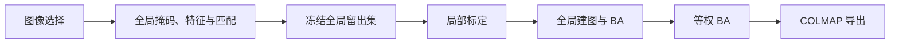

# 跨阶段观测留出

新构建在任何局部或全局几何拟合开始前，先冻结同一份全局留出集。局部标定使用全局特征的原始编号，排除其中全部留出观测。该约束覆盖正式 `build-baseline` 管线；历史实验仍按各自协议运行。

## 阶段顺序



对应 `--stage prepare|global-data|holdout|local-calibration|global-sfm|equal-ba|export`。默认 `all` 按上图执行，单独阶段要求上游已完成。新工作目录的完整命令为：

```bash
uv run --no-sync geosunpre build-baseline \
  --input input/篮球场 --work work/basketball_isolated_01
```

全局匹配完成后，也可分阶段执行：

```bash
uv run --no-sync geosunpre build-baseline --work work/basketball_isolated_01 --stage holdout
uv run --no-sync geosunpre build-baseline --work work/basketball_isolated_01 --stage local-calibration
uv run --no-sync geosunpre build-baseline --work work/basketball_isolated_01 --stage global-sfm
```

## 排除规则

- 按原有确定性策略，从满足长度及帧跨度条件的原始匹配轨迹中抽取 20%，种子为 `314159`；轨迹的全部观测用于排除。接触任一留出观测的匹配边在两视图几何估计前被移除，包括未被原始成轨合并接受的冲突边。
- 高置信评估子集仍要求支持点和查询点之间存在置信度至少 0.9 的直接闭合三图匹配；子集在标定前冻结，不参考位姿或重投影误差。
- 当前局部标定区间仍为 70–94。其场景、掩码、特征与匹配直接引用全局准备产物，不重新提取或重编号。
- 局部划分是全局排除集合的投影。只有一个或两个局部观测的轨迹仍参与排除，不生成局部评估查询；至少三个观测且帧跨度满足条件时，按帧顺序选首尾支持点，其余作为查询。
- 空查询显式记录 `no_queries`。有效性检查不会将空查询解释为几何质量合格。

## 内容身份与续跑检查

| 产物 | 作用 |
| --- | --- |
| `global_sfm/holdout_protocol.json` | 保存场景、前端语义身份、配对协议、特征/匹配缓存内容哈希及两个划分文件哈希；最后写入，标志冻结完成 |
| `global_sfm/split.json` | 全局原始留出轨迹、支持点与查询点 |
| `global_sfm/triangle_validation_split.json` | 原始留出的高置信子集 |
| `local_sfm/normal_070_094/split.json` | 局部观测投影，保留不足以评估的排除观测 |
| `local_sfm/normal_070_094/run_contract.json` | 局部几何版本 2、全局留出身份与实际使用的特征、配对、局部划分 |
| `local_sfm/calibration_identity.json` | 完成标定后记录场景、前端、划分、运行协议、mapping 及各 BA 阶段模型和求解报告的哈希 |
| `global_sfm/geometry_protocol.json` | 全局几何版本 2，绑定全局留出和完整标定身份 |

局部标定、全局建图/求解/评估、等权 BA 和正式候选导出均检查这些依赖。即使缓存 token 未改变，特征坐标重排或匹配内容变化也会导致拒绝续跑。泄漏检查使用显式异常，在 `python -O` 下仍有效。已存在几何但缺少新协议的目录不能补写新身份后继续使用。

缓存统计计数不参与前端语义身份。每次进入这些阶段都会读取相关缓存计算内容哈希，全量检查耗时尚未测量。当前约束保证输入变化可被检测；完整数据库/种子断点恢复及工作目录并发锁仍是后续工作。

## 历史产物和证据边界

旧基线的划分发生在局部标定之后，不能通过换标签获得新的隔离保证。它继续通过 `baseline-check` 审计，也可用 `export-baseline` 或 `export-colmap` 输出 COLMAP。新流程应使用新的工作目录和重新计算的标定。

候选导出的来源信息记录留出协议和标定身份哈希；交付后的 `check-colmap` 仍只检查导出包，不要求持有上游缓存。评估报告通过 `holdout_isolation` 区分新协议与历史 `stage_only` 协议。

本轮 CPU 测试覆盖先后依赖、特征编号复用、短轨迹排除、实际进入两视图几何前的匹配过滤、缓存/划分/标定变化拒绝、旧模型拒绝、续跑、空查询和候选导出。管线集成测试使用真实文件与 PyCOLMAP 模型序列化，对建图和 BA 使用替身；未运行完整 536 张图的新流程，不能据此声称重建精度改善。

该留出仍来自同一批图像及原始匹配，图像通过其余特征参与拟合。其用途是跨阶段观测预测诊断，不提供独立采集或真实三维点的验收证据，也不定义下游训练/测试划分。
